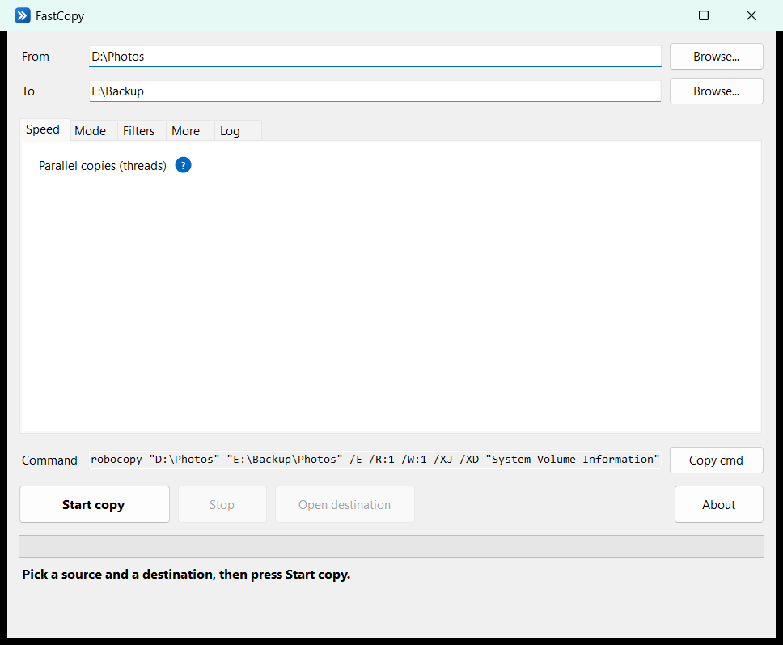
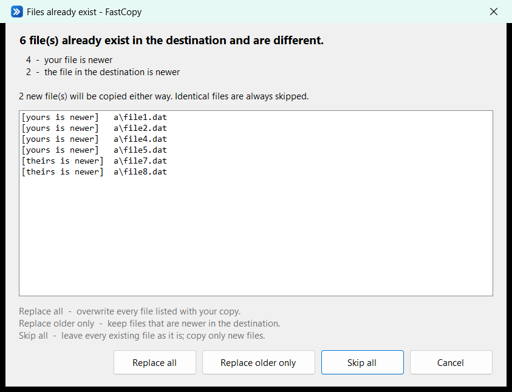
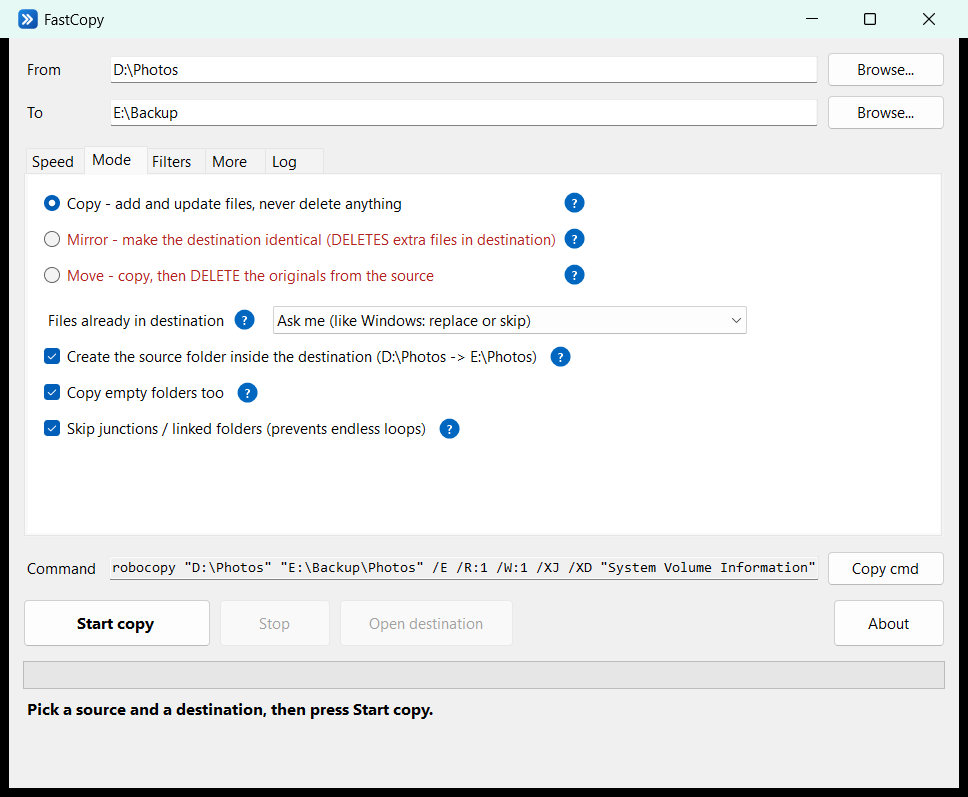

# FastCopy

**Fast multi-threaded file copier for Windows.** A friendly window on top of `robocopy /MT`, the multi-threaded copy engine already built into Windows.

Free, open source, portable: **one .exe, nothing to install.**



## Download

**[Download FastCopy.exe](https://github.com/jawad-hamza/fastcopy/raw/main/portable/FastCopy.exe)** (single portable file, 84 KB)

- Works on Windows 10 and 11 (uses .NET Framework 4.8, which is built in).
- Just double-click it. No installer, no admin rights, no PowerShell.
- The exe isn't code-signed, so Windows SmartScreen may say *"Windows protected your PC"* the first time. Click **More info → Run anyway**. The full source is in this repo, and you can build it yourself (see below).

## Why

Windows Explorer copies **one file at a time**. With a folder of thousands of small files (photos, documents, code), most of the time goes into per-file overhead, not into moving data, so the speed drops to a few KB/s.

`robocopy` can copy many files **in parallel** (`/MT`), but it's a command-line tool with dozens of switches. FastCopy gives it a simple window, live progress, and plain-English help for every option.

## Benchmarks

Measured on a laptop (Intel i5-13450HX, 16 GB RAM, Windows 11, Micron NVMe SSD), copying within the same drive. Each result is the median of 3 runs. Every copy was verified, and the disk was idle before each run. [Full results and method](benchmark/results-C.md).

**10,000 small files (4 KB each, like a code or documents folder):**

| Method | Time | vs Explorer |
|---|---:|---:|
| Windows Explorer copy engine | 33.5 s | 1x |
| PowerShell `Copy-Item` | 21.0 s | 1.6x |
| robocopy, single-threaded | 6.0 s | 5.5x |
| robocopy, 8 threads | 2.5 s | 13.4x |
| robocopy, 32 threads | **2.3 s** | **14.7x** |
| **FastCopy, 16 threads** (includes its scan pass) | 3.4 s | 9.9x |

**Honest notes:**

- FastCopy is about 1 s slower than raw robocopy here, because it scans first. The scan powers the progress bar, time-left, the replace/skip question and the free-space check.
- **Big files (photos, videos): no clear winner.** Once files are large, the drive is the bottleneck and every method lands in the same range. More threads can't make a drive faster than it is.

Test your own drive (it creates test data, copies it with every method, then deletes everything):

```bat
powershell -ExecutionPolicy Bypass -File benchmark\bench.ps1 -Target E:\
```

## Features

- **Parallel copying:** choose 1 to 128 threads with a slider, presets, or a **MAX** button.
- **Live progress:** files and bytes done, MB/s, files/s, time left, errors. Progress also shows on the taskbar button.
- **Replace or skip, like Windows:** after scanning, FastCopy lists the files that already exist in the destination and asks once: *Replace all*, *Replace older only*, *Skip all*, or *Cancel*. (Asking per file wouldn't work, because files are copied in parallel.)
- **Copy, Mirror, or Move** modes. The ones that delete files are marked in red and ask for confirmation.
- **Filters:** only certain files (`*.jpg *.mp4`), exclude files or folders (`node_modules .git`), and min/max size or max age.
- **Plain-English help:** hover any blue **?** for an explanation written for non-techies.
- **Stop any time.** Press Start again later to resume; finished files are skipped.
- **Safe defaults:**
  - Never deletes anything unless you choose Mirror or Move.
  - Skips junction loops and `System Volume Information`.
  - Warns if the destination is short on space.
- **Keeps the PC awake** during long copies.
- Shows the **exact robocopy command**, which you can copy for scripts.
- Drag and drop folders onto the From/To boxes. Settings are remembered.

| Replace or skip | Options with help |
|---|---|
|  |  |

## How to use

1. Pick **From** (the folder to copy) and **To** (where it should go). Drag and drop works.
2. Optionally set the number of threads in the **Speed** tab (16 is a good default).
3. Press **Start copy**.

### How many threads?

| Drive | Good starting point |
|---|---|
| USB pen drive / SD card | 8 - 32 |
| External SSD | 32 - 64 |
| Internal SSD / NVMe | 64 - 128 |

More threads help most with **many small files**. For a few huge files (videos, ISOs), threads barely matter; the drive and cable are the limit. Turn on *Unbuffered I/O* in the Speed tab for those.

### Slow USB? Check these first

- **USB 2.0 caps you at ~35 MB/s**, whatever the software. Use a USB 3 port (often blue, or marked SS) and a USB 3 cable.
- **Phones (MTP)** show up under *This PC* without a drive letter. Neither robocopy nor FastCopy can read those. For Android, `adb pull /sdcard/DCIM D:\Backup` is much faster than Explorer.
- Thousands of tiny files? Zipping them first and copying one big file is also very fast.

## Portable mode

Settings are saved in `%APPDATA%\FastCopy\FastCopy.ini`. To keep everything on a USB stick, create an empty file named `FastCopy.ini` next to `FastCopy.exe`. FastCopy will then save its settings there instead.

## Repository layout

| Path | What it is |
|---|---|
| `portable/FastCopy.exe` | The portable app (built from `src/`) |
| `src/FastCopy.cs` | Source of the portable app (C# / WinForms, single file) |
| `src/app.manifest`, `src/FastCopy.ico`, `src/make-icon.ps1` | Manifest (DPI-aware, modern controls), icon, and the script that draws the icon |
| `build.bat` | Builds `portable/FastCopy.exe` |
| `original/FastCopy.ps1` + `FastCopy.bat` | The original PowerShell version (same features, minus the replace/skip dialog) |
| `benchmark/bench.ps1` | The benchmark script; `benchmark/results-*.md` are its results |

## Build from source

No SDK or Visual Studio needed. The C# compiler ships with Windows:

```bat
build.bat
```

This produces `portable\FastCopy.exe`.

## Credits

**Created by [Jawad Hamza](https://github.com/jawad-hamza).**

The copying itself is done by `robocopy`, which is part of Windows. FastCopy is not affiliated with Microsoft.

## License

[MIT](LICENSE): free for everyone, for personal or commercial use. You can share and modify it; please keep the copyright notice and credit to the author.
